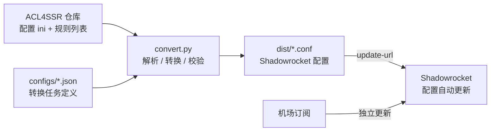

# Shadowrocket 配置转换

[](https://github.com/Jedeiah/shadowrocket-convert/actions/workflows/update.yml)
[](https://github.com/Jedeiah/shadowrocket-convert/commits/main)
[](LICENSE)
[](https://github.com/Jedeiah/shadowrocket-convert)

> 将 **subconverter / ACL4SSR 风格的 Clash 规则配置**批量转换为 **Shadowrocket（小火箭）可导入的 `.conf`**，
> 支持多转换任务、GitHub Actions 每日自动更新，以及与 Clash 端保持一致的规则顺序和策略分组。

---

## 目录

- [项目简介](#项目简介)
- [核心特性](#核心特性)
- [数据流](#数据流)
- [内置转换](#内置转换)
- [快速开始](#快速开始)
- [在 Shadowrocket 中使用](#在-shadowrocket-中使用)
- [自定义转换](#自定义转换)
- [本地运行](#本地运行)
- [更新机制](#更新机制)
- [兼容性与已知差异](#兼容性与已知差异)
- [常见问题](#常见问题)
- [安全与隐私](#安全与隐私)
- [贡献](#贡献)
- [鸣谢](#鸣谢)
- [免责声明](#免责声明)
- [License](#license)

---

## 项目简介

Shadowrocket 仅接受其自有 `.conf` 配置格式，无法直接使用 Clash / mihomo 的 YAML 规则。
本项目提供一条可维护的转换流水线：

- 以 **subconverter 配置（`.ini`）** 为输入源（默认为 ACL4SSR 系列配置）；
- 解析其 `ruleset=` 规则列表与 `custom_proxy_group=` 策略分组，按原顺序生成 Shadowrocket `.conf`；
- 通过 GitHub Actions 在 **每日定时、推送 `main`、手动触发**时自动重建产物；
- 产物只包含**规则与策略分组**，不包含任何节点；节点由 Shadowrocket 中的机场订阅独立管理。

本项目**不提供、不托管任何代理服务或节点**。

## 核心特性

| 特性 | 说明 |
|---|---|
| **多转换任务** | `configs/*.json` 每个文件定义一个转换；新增转换只需加 JSON，无需修改代码 |
| **与上游同步** | 每日 03:17 UTC 自动重建；`main` 分支推送即触发；支持手动触发 |
| **规则一致性** | 保留上游规则顺序、分组名称与默认策略；策略校验失败时构建直接失败 |
| **零第三方依赖** | 单个 Python 3 标准库脚本，无 pip 依赖 |
| **产物零 Artifact** | 不使用 `upload-artifact`，不占用 Actions 存储；仅提交 `dist/` 产物 |
| **可定制** | 支持 `prepend_rules` / `append_rules` 为单个配置追加规则 |
| **可自托管** | 分钟级部署到任意 GitHub 账号，产物通过 raw 链接使用 |

> 基准数据：`ACL4SSR_Online_Full` → **29 个策略组、10,401 条规则**，与 Clash Verge 端使用同一套规则。

## 数据流



## 内置转换

| ID | 上游配置 | 策略组 | 规则数 | 产物大小 | 默认启用 |
|---|---|---|---|---|---|
| `acl4ssr-online-full` | `ACL4SSR_Online_Full.ini` | 29 | 10,401 | ≈471 KB | ✅ |
| `acl4ssr-online` | `ACL4SSR_Online.ini` | 11 | 3,526 | ≈163 KB | ✅ |
| `acl4ssr-mini-ai` | `ACL4SSR_Online_Mini_Ai.ini` | 6 | 3,440 | ≈158 KB | ✅ |
| `acl4ssr-full-adblockplus` | `ACL4SSR_Online_Full_AdblockPlus.ini` | 31 | 96,329 | ≈4.6 MB | ⛔ |

- 默认启用的三个配置覆盖了“完整分流 / 精简 / AI 精简”三类常见场景；
- `acl4ssr-full-adblockplus` 规则量与体积较大，默认关闭；需要时修改其 `configs/*.json` 中的
  `"enabled": true` 即可启用。

## 配置链接（自动生成）

<!-- CONFIG-LINKS:START -->

> 本节由 `convert.py` 自动生成（每次构建刷新），请勿手工修改。

| 配置 | 说明 | 大小 |
|---|---|---|
| `acl4ssr-mini-ai` | ACL4SSR Online Mini_Ai（精简 + Ai平台 组） | 158 KB |
| `acl4ssr-online-full` | ACL4SSR Online Full（与小猫同款） | 471 KB |
| `acl4ssr-online` | ACL4SSR Online（原版 11 组） | 163 KB |

### 可复制链接

**ACL4SSR Online Mini_Ai（精简 + Ai平台 组）**（`acl4ssr-mini-ai`）

```
https://raw.githubusercontent.com/Jedeiah/shadowrocket-convert/main/dist/acl4ssr-mini-ai.conf
```

**ACL4SSR Online Full（与小猫同款）**（`acl4ssr-online-full`）

```
https://raw.githubusercontent.com/Jedeiah/shadowrocket-convert/main/dist/acl4ssr-online-full.conf
```

**ACL4SSR Online（原版 11 组）**（`acl4ssr-online`）

```
https://raw.githubusercontent.com/Jedeiah/shadowrocket-convert/main/dist/acl4ssr-online.conf
```

<!-- CONFIG-LINKS:END -->

## 快速开始

### 1. 创建仓库

将本仓库 **Fork** 到自己的账号，或把以下文件上传至一个新的 **Public** 仓库：

```
configs/
convert.py
.github/workflows/update.yml
```

> 必须为 Public 仓库：Shadowrocket 需要通过 raw 链接直接下载配置。

### 2. 开启 Actions 写权限

仓库 → **Settings → Actions → General → Workflow permissions** → 选择 **Read and write permissions** → Save。

### 3. 运行一次

仓库 → **Actions → Update Shadowrocket configs → Run workflow**。

执行完成后，产物位于 `dist/`，链接清单见 `dist/links.md`。

### 4. 获取配置链接

```
https://raw.githubusercontent.com/<用户名>/<仓库名>/main/dist/<配置 ID>.conf
```

## 在 Shadowrocket 中使用

1. Shadowrocket → **配置** → 右上角 `+` → 粘贴配置 raw 链接 → 下载；
2. 点击该配置，设为**使用中**；
3. 长按配置 → 开启 **自动更新**（建议 24 小时）；
4. 返回首页 → `+` → 类型选择 **Subscribe** → 粘贴机场订阅链接；
5. 连通性测试后选择节点；
6. 在配置详情 → **策略组** 中逐组选择节点，例如将 `💬 Ai平台` 指定为 `🇺🇸 美国节点` 或 `🇯🇵 日本节点`。

策略组通过 `policy-regex-filter` 依据**节点名称关键词**自动匹配（如 `香港 / HK`、`Japan / 日本`、`美国 / US`）。
若某分组为空，请检查订阅节点命名是否包含对应关键词。

## 自定义转换

在 `configs/` 新建 `<id>.json` 即可新增一个转换任务：

```json
{
  "id": "my-config",
  "title": "我的配置",
  "enabled": true,
  "ini": "https://raw.githubusercontent.com/<owner>/<repo>/<branch>/<path>.ini",
  "output": "dist/my-config.conf",
  "prepend_rules": [],
  "append_rules": []
}
```

字段、约束与校验规则详见 [`configs/README.md`](configs/README.md)。

提交并推送至 `main` 后，Actions 会自动生成 `dist/my-config.conf` 并更新 `dist/links.md`。

## 本地运行

```bash
# 转换全部启用的任务
python3 convert.py

# 仅转换指定任务
python3 convert.py --only acl4ssr-online-full

# 生成带 update-url 的产物（用于自托管）
BASE_RAW_URL="https://raw.githubusercontent.com/<owner>/<repo>/main" python3 convert.py
```

| 环境变量 | 说明 |
|---|---|
| `BASE_RAW_URL` | 产物中 `update-url` 的基地址；设置后同时生成 `dist/links.md` |

## 更新机制

| 触发方式 | 条件 | 说明 |
|---|---|---|
| 定时 | 每天 03:17 UTC（北京时间 11:17） | 全量重建 |
| 推送 | 推送到 `main` 分支 | 全量重建 |
| 手动 | Actions → Run workflow | 全量重建 |

- 工作流使用 `GITHUB_TOKEN` 提交产物，**不会再次触发** `push` 事件，无循环触发风险；
- 工作流不生成 Actions artifact，仅提交 `dist/` 中变化的内容；
- 上游规则未变化时，提交步骤自动跳过（无空提交）。

## 兼容性与已知差异

| 项目 | 说明 |
|---|---|
| `PROCESS-NAME` / `SRC-IP-CIDR` / `DST-PORT` / `PROTOCOL` | iOS 不支持，转换时跳过（当前上游约 18 条） |
| `🚀 手动切换` 分组 | Clash 中为“手动选择全部节点”，Shadowrocket 中转为 `url-test`；手动选节点由 `PROXY`（首页选中节点）承担 |
| `🎥 奈飞节点`、`🎶 网易音乐` 等 | 由 `select` + 正则转换为 `url-test`，按节点名关键词自动匹配 |
| DNS | 使用 Shadowrocket 默认 DNS 策略；如需 DoH，可在生成的 `[General]` 中追加 `dns-server` |
| 节点 | 不写入配置；由机场订阅独立更新，与规则更新互不影响 |

## 常见问题

<details>
<summary><strong>Q1：为什么不把节点写进配置文件？</strong></summary>

机场订阅与规则属于两条独立更新链路。将节点写入配置会导致：

- 每次规则更新都要重新拉取节点，失败风险叠加；
- 机场更换节点后配置过期；
- 配置文件中出现订阅凭证，存在泄露风险。

因此本项目只生成规则与策略分组，节点由 Shadowrocket 的订阅功能管理。
</details>

<details>
<summary><strong>Q2：策略组显示为空 / 节点匹配不到怎么办？</strong></summary>

策略组通过节点名称关键词匹配。请确认订阅节点名称包含地区关键词（如 `香港`、`HK`、`日本`、`JP`、`美国`、`US`）。若机场命名不规范，可在订阅中重命名节点，或修改生成配置中的 `policy-regex-filter`。
</details>

<details>
<summary><strong>Q3：私有仓库可以使用吗？</strong></summary>

不可以直接使用。私有仓库的 raw 链接需要认证，Shadowrocket 无法携带 Token 下载。若需私有化，请自行搭建带鉴权的反向代理，或仅在本地生成后导入。
</details>

<details>
<summary><strong>Q4：规则多久更新一次？</strong></summary>

上游 ACL4SSR 仓库更新后，GitHub Actions 在每日定时或下一次推送时重建；Shadowrocket 按其“配置自动更新”间隔（建议 24 小时）拉取。两段延迟叠加后通常为 1 天以内。
</details>

<details>
<summary><strong>Q5：可以转换非 ACL4SSR 的配置吗？</strong></summary>

可以。只要输入为 subconverter 风格 `.ini`（包含 `ruleset=` 与 `custom_proxy_group=` 语法），即可在 `configs/` 中新增任务进行转换。
</details>

## 安全与隐私

- 仓库仅包含公开的 ACL4SSR 规则源地址与转换脚本，**不包含任何节点、订阅链接、Token 或凭证**；
- 工作流仅使用 `actions/checkout` 与 `actions/setup-python`，不接收外部输入；
- 提交身份使用 GitHub noreply 邮箱，避免暴露个人信息；
- 若仓库改为私有，`raw` 链接将失效（见 FAQ Q3）。

## 贡献

1. Fork 本仓库并创建特性分支；
2. 新增转换任务时，请在 `configs/` 中增加 JSON 文件，或修改 `convert.py` 的通用转换逻辑；
3. 提交前请本地执行 `python3 convert.py`，确保转换成功且产物可正常导入；
4. 通过 Pull Request 提交，并说明变更内容与验证结果。

## 鸣谢

- [ACL4SSR](https://github.com/ACL4SSR/ACL4SSR) —— 规则与策略分组源；
- [subconverter](https://github.com/tindy2013/subconverter) —— `.ini` 配置语法约定；
- Shadowrocket —— 目标客户端。

## 免责声明

- 本项目仅进行**规则格式转换**，不提供任何代理服务、节点或网络接入能力；
- 所有规则的著作权归上游项目及原作者所有，本项目仅按其公开格式进行转换分发；
- 使用本项目产生的任何后果由使用者自行承担，请遵守所在国家或地区的法律法规；
- 若上游项目或相关方认为本项目存在不当之处，请提交 Issue，将及时处理。

## License

本项目基于 [MIT License](LICENSE) 开源。
